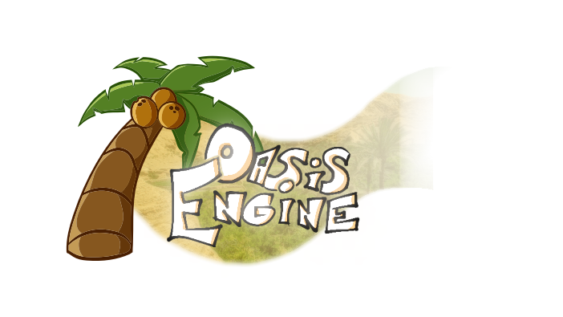
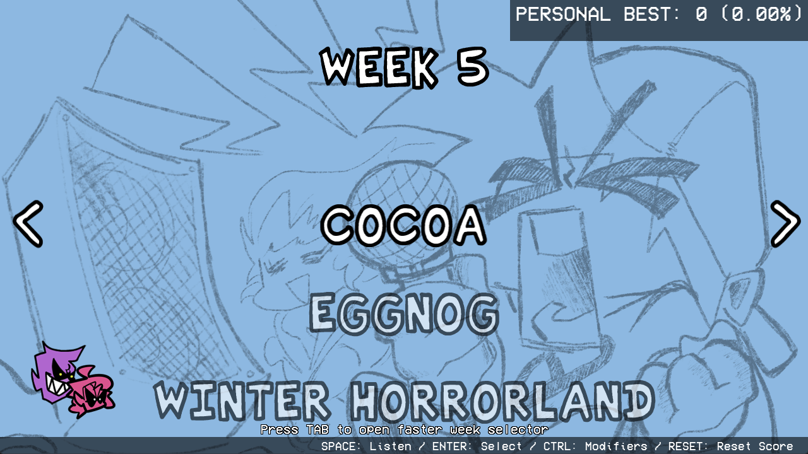
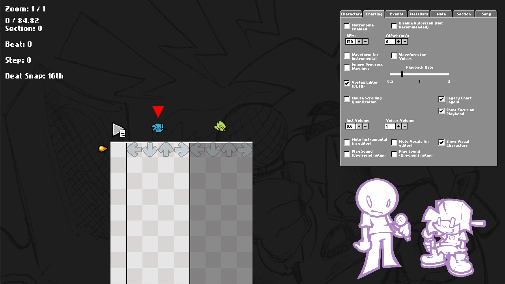
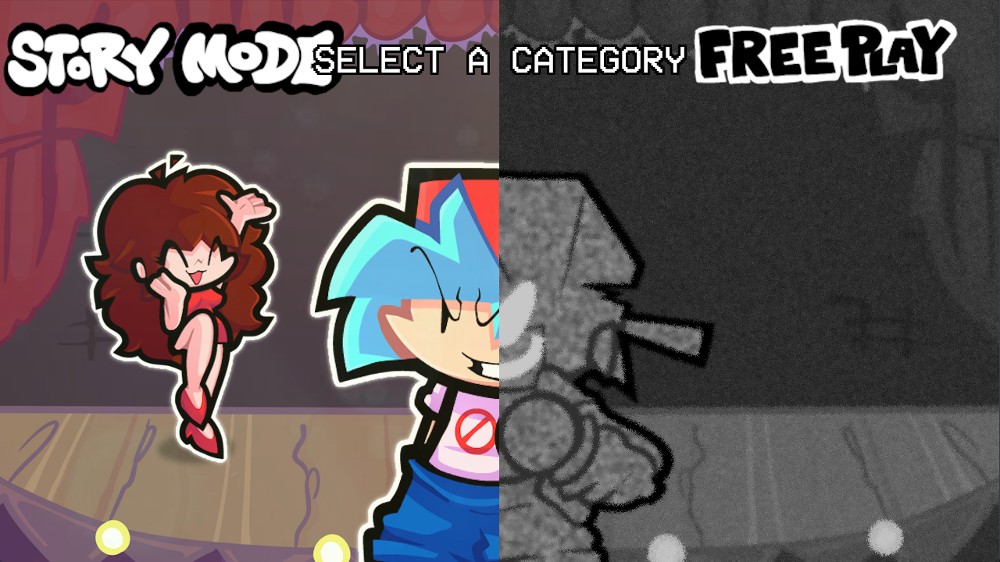
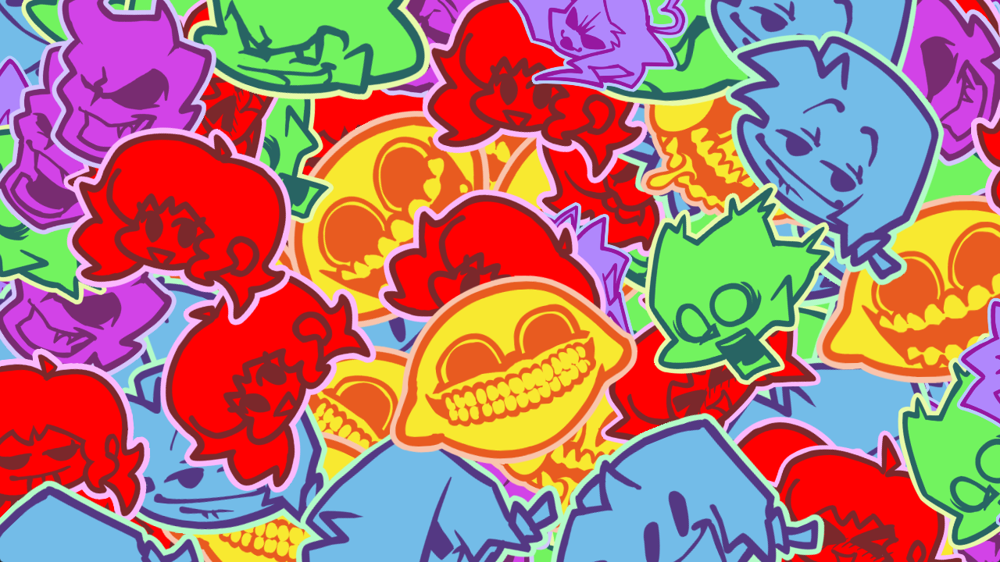
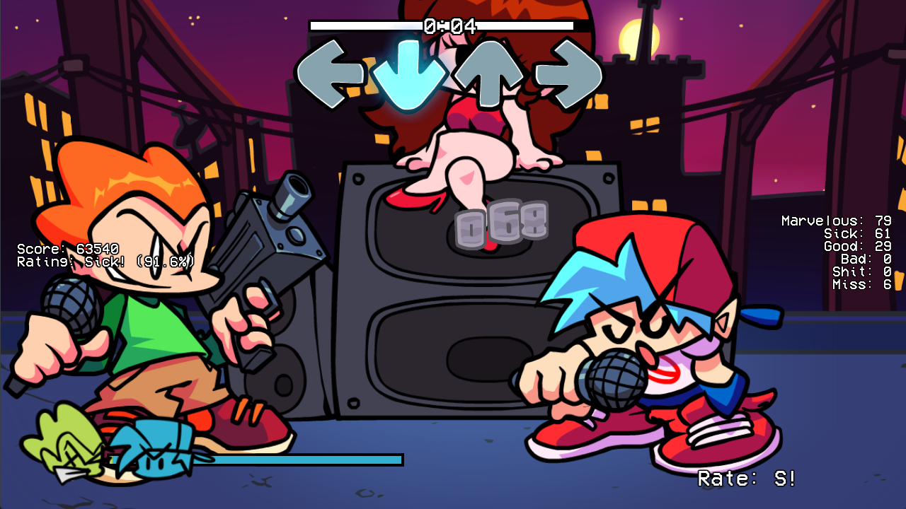

# Oasis Engine



**A standalone Friday Night Funkin' engine built on Psych Engine 0.6.3, with native extra characters, a camera timeline editor, and a redesigned Freeplay.**

[Source](https://github.com/kosziPL/oasis-engine) · [Releases](https://github.com/kosziPL/oasis-engine/releases) · [Issues](https://github.com/kosziPL/oasis-engine/issues) · [Modding](Modding.md) · [Building](docs/BUILDING.md) · [Contributing](docs/BRANCHES.md) · [Feature audit](docs/FEATURE_AUDIT.md)



> **Early, experimental development.** APIs, chart formats, and editor behavior may change. The source version is `0.2.8`; this does not identify an available public release. See the [known limitations](docs/FEATURE_AUDIT.md#limitations-and-unfinished-work).

Oasis Engine is a standalone engine for creating and running Friday Night Funkin' mods. [kosziPL/oasis-engine](https://github.com/kosziPL/oasis-engine) is the official source for engine code, documentation, releases, and issue tracking.

Read [a personal note from Koszi](READ%20IT%20OR%20IDK.md) about the project's history and current direction.

## What makes Oasis different?

### More characters, one chart

Add extra performers directly in the Chart Editor. Each can have its own side, position, draw layer, and four note columns. Character IDs also drive section camera focus and character events. **Bot Notes** let additional performers sing without adding playable notes.

The editor includes a Characters tab, animated character previews, a legacy chart layout, a focus indicator, multi-note selection and dragging, clipboard operations, undo, character-to-character section swapping, and a playtest speed control. Its Metadata tab stores author credits. Per-character note skins, Game Over Character, and the camera-editor toggle are exposed by the editor but are not currently consumed by gameplay.



### Direct the camera on a timeline

The **Camera Editor** provides a song selector, timeline pins, a live stage view, and an inspector for position, zoom, easing, and duration. Events can target performers or world positions, use relative coordinates, take over normal tracking, and suppress note-driven movement. Press **H** for help and **Ctrl+S** to save.

Gameplay also adds configurable movement on note hits, instant camera positioning, and split-screen events with an adjustable divider. Camera-file paths have a known mismatch between saving and loading; see the [limitations](docs/FEATURE_AUDIT.md#limitations-and-unfinished-work) before relying on saved tracks in a release.

### A different Freeplay flow

- Browse categories, weeks, songs, and available difficulties.
- Press **Tab** in the song list to jump to a week.
- Press **Space** to preview a song with vocals. During preview, **Up/Down** changes speed and **Left/Right** seeks five seconds.
- Open gameplay modifiers with **Ctrl**; confirm with **Enter** and go back with **Escape**.
- Return through sticker transitions, with the previous selection remembered.





### Gameplay and presentation

- A **Marvelous** judgement: a 20 ms window and 500 points.
- Oasis and legacy HUD layouts, judgement counters, and configurable rating/combo placement.
- Multiple health icons and optional three-frame icons with a winning expression.
- New built-in events: `Change Icon`, `Show Extra Character`, `Toggle Split Screen`, `Set Split Position`, and `Instant Cam Pos`.
- The 16 base FNF/Psych 0.6.3 achievements and their original unlock conditions, an extra award for setting 1000 FPS, and individual/all-achievement reset controls.
- Revised main-menu and pause presentation.
- A song-loading error screen with routes back to Freeplay or into the Chart Editor.



### Modding and engine internals

Content lives in `assets/fnf/` and `assets/custom/<mod>/`. Oasis adds asset priority overrides, custom base-week preferences, character-attached Lua scripts, and seven Lua callbacks for character discovery, camera control, and shader colors.

The loading pipeline includes background asset reads/decoding, main-thread dispatch, incremental note creation, BSON chart caches, Lua source caching, and optional GPU texture caching. These are implemented mechanisms, **not measured performance promises**. GPU caching is disabled by default and can cause visual issues on some hardware.

The [feature audit](docs/FEATURE_AUDIT.md) contains the reviewed inventory, source references, historical scope, and unfinished features. Standard Psych features such as Lua modcharts, Story Mode, dialogue editors, and Discord Rich Presence are inherited.

## Play

Download your platform's archive from [Releases](https://github.com/kosziPL/oasis-engine/releases), when available, extract the entire archive, and launch `OasisEngine` (`OasisEngine.exe` on Windows). Keep the executable and its assets together. Development build artifacts are available through [Actions](https://github.com/kosziPL/oasis-engine/actions) when a build has completed; they are not tagged releases.

CI defines Windows, Linux, and macOS builds. This does not certify all three platforms: see [validation status](docs/BUILDING.md#validation-status). Browser, mobile, and Switch release support is not claimed.

## Build from source

Use **Haxe 4.2.5** with the versions in the [build guide](docs/BUILDING.md). Do not upgrade HaxeFlixel/OpenFL independently: this engine overrides library classes.

With dependencies installed, run from the repository root:

```sh
haxelib run lime test linux
# Windows: haxelib run lime test windows
# macOS:   haxelib run lime test mac
```

For a distributable Linux build:

```sh
haxelib run lime build linux -final
```

The resulting game is in `export/release/linux/bin/`. Build from a clean checkout of [the official repository](https://github.com/kosziPL/oasis-engine). Desktop builds also copy any mods present in `assets/custom/`; no extra build flag is needed. The [build guide](docs/BUILDING.md) covers setup scripts, native toolchains, other platforms, and dependency limitations.

## Repository layout

```text
assets/fnf/          Base game content and engine UI
assets/custom/       Installed custom mods
source/              Engine, gameplay, editors, and library overrides
art/                 Editable artwork and build icons
docs/               Website, guides, screenshots, and audit
docs/history/       Archived upstream and engine development notes
tools/              Engine branch synchronization and tests
.github/             Build/release workflow and issue templates
```

Local libraries, build output, Node dependencies, and generated BSON files are ignored by Git. Editable artwork is retained intentionally. See [Contributing](docs/BRANCHES.md) for the development workflow.

## Compatibility and reporting bugs

Oasis is based on [the official Psych Engine 0.6.3 tag](https://github.com/ShadowMario/FNF-PsychEngine/tree/0.6.3). Its asset layout, numeric character targets, and chart lane ownership differ from upstream. Existing Psych mods may need migration; consult the [modding guide](Modding.md).

Report engine issues in [Issues](https://github.com/kosziPL/oasis-engine/issues) with your platform, commit or release version, song or mod, reproduction steps, and available crash logs. The [release checklist](docs/RELEASE_CHECKLIST.md) records remaining manual checks; a successful compile alone does not establish gameplay stability.

## Credits

- **Koszi / [kosziPL](https://github.com/kosziPL)** — programming and maintenance.
- **JkbItaPlay** — engine design, music, and creative direction.
- **Skwarix** - Additional artist & animator.
- **Psych Engine** — Shadow Mario, RiverOaken, shubs, bb-panzu, and contributors.
- **Friday Night Funkin'** — ninjamuffin99, PhantomArcade, evilsk8r, and kawaisprite.
- **Haxe, HaxeFlixel, OpenFL, Lime**, and the projects supplying the engine's dependencies.

Further credits are preserved in the in-game Credits screen. AI-assisted tools have been used during implementation, debugging, refactoring, and documentation; project direction and maintenance remain with the developers.

See [LICENSE](LICENSE) for the repository license. Existing credits and notices are retained.
